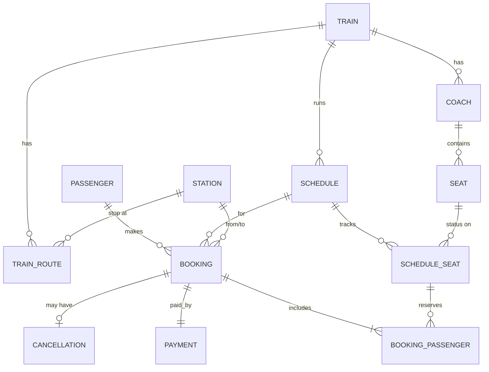

# ER Diagram (render in GitHub or mermaid.live, export as image for the report)

Business rules: a seat can be held by only one active passenger per schedule; a station appears once per train route; cancellation refunds 90% (2+ days before travel), 50% (1 day), 0% (same day); total fare = sum of passenger fares.
